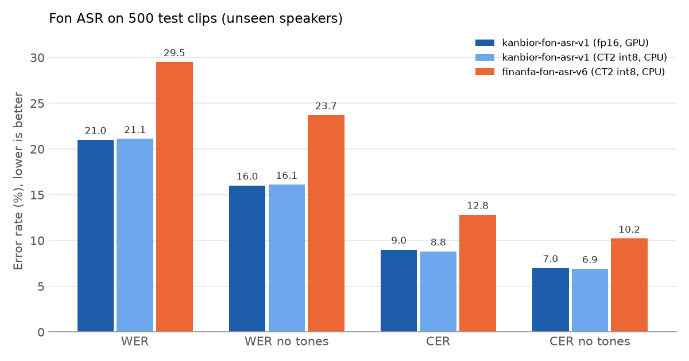

---
language:
- fon
language_details: fon-Latn
license: cc-by-sa-4.0
library_name: transformers
pipeline_tag: automatic-speech-recognition
base_model: openai/whisper-small
datasets:
- JaimeMaLangue/JML-fon-speech-v1
tags:
- kanbior
- whisper
- fon
- speech-recognition
metrics:
- wer
- cer
---

# kanbior-fon-asr-v1

Fon speech recognition, fine-tuned from [openai/whisper-small](https://huggingface.co/openai/whisper-small)
on [JML-fon-speech-v1](https://huggingface.co/datasets/JaimeMaLangue/JML-fon-speech-v1).
Output is Fon text with tone marks.

It is the speech recognition part of Kanbior, a voice assistant in Fon.

Code (data preparation, training and evaluation): [github.com/dyeto/kanbior](https://github.com/dyeto/kanbior).

## Usage

```python
from transformers import pipeline

asr = pipeline("automatic-speech-recognition", model="dyeto/kanbior-fon-asr-v1")
print(asr("audio.wav", generate_kwargs={"language": "fr", "task": "transcribe"})["text"])
```

Whisper has no Fon language token: the model was trained with the French token, so always pass
`language="fr"`. Audio is resampled to 16 kHz.

### faster-whisper

A [CTranslate2](https://github.com/OpenNMT/CTranslate2) version for faster-whisper is in
[kanbior-fon-asr-v1-ct2](https://huggingface.co/dyeto/kanbior-fon-asr-v1-ct2):

```python
from faster_whisper import WhisperModel

model = WhisperModel("dyeto/kanbior-fon-asr-v1-ct2", device="cpu", compute_type="int8")   # GPU: device="cuda", compute_type="float16"
segments, _ = model.transcribe("audio.wav", language="fr", beam_size=1, without_timestamps=True)
print(" ".join(s.text.strip() for s in segments))
```

## Examples

Two clips from validation speakers (not used for training), with the
[JML-fon-speech-v1](https://huggingface.co/datasets/JaimeMaLangue/JML-fon-speech-v1) clip id:

| Clip | | Text |
|---|---|---|
| tr_000001 | Reference | Kèmi ná yi azɔ̌mɛ ɖo Canada é ná yí ɖo semaine e jǎwe ɔ́ mɛ. |
| | Predicted | Kɛ́mi ná yí azɔ̌mɛ ɖo Canada. É ná yí ɖo semaine e jǎwe ɔ́ mɛ. |
| tr_000002 | Reference | Un mɔ nyaví ɖokpó bɔ é ká nyí nyaví vɔvɔ ɖé lobɔ é ɖo sin ɖe dó nɛgbé wɛ. |
| | Predicted | Mǐ mɔ nyaví ɖokpó bɔ é ká nyaví vɔvɔ ɖé lobɔ é ɖo sin ɖé bló nɛgbé wɛ. |

## Results

Test set: 6,724 clips (14.0 h) from 137 speakers not seen in training or validation.
WER and CER are the word and character error rates (lower is better).
"No tones" scores remove tone marks from both reference and prediction before scoring.

| Model | WER | WER no tones | CER | CER no tones |
|---|---|---|---|---|
| kanbior-fon-asr-v1 | 20.5 | 15.5 | 8.5 | 6.6 |

Comparison with [finanfa-fon-asr-v6](https://huggingface.co/finanfa-tech/finanfa-fon-asr-v6)
on the same 500 test clips, picked at random (greedy decoding):

| Model | Runtime | WER | WER no tones | CER | CER no tones |
|---|---|---|---|---|---|
| kanbior-fon-asr-v1 | transformers, fp16, GPU | 21.0 | 16.0 | 9.0 | 7.0 |
| kanbior-fon-asr-v1 | faster-whisper, int8, CPU | 21.1 | 16.1 | 8.8 | 6.9 |
| finanfa-fon-asr-v6 | faster-whisper, int8, CPU | 29.5 | 23.7 | 12.8 | 10.2 |

The two faster-whisper rows use the same runtime, precision and decoding settings.



finanfa-v6 may have been trained on some of these speakers, which would favour it.

Validation (300 clips) during training:

| Step | WER | WER no tones | CER | CER no tones |
|---|---|---|---|---|
| 2,000 | 23.6 | 18.0 | 9.5 | 7.3 |
| 4,000 | 19.6 | 14.8 | 7.8 | 6.0 |
| 6,000 | 19.1 | 14.0 | 7.6 | 5.7 |
| 8,000 | 18.7 | 13.7 | 9.2 | 7.5 |
| 10,000 | 18.5 | 13.6 | 9.1 | 7.5 |
| 12,000 (this model) | 18.7 | 13.8 | 9.3 | 7.6 |

## Training

- Data: all transcribed audio of JML-fon-speech-v1, split by speaker (about 80/10/10 by hours):
  train 50,675 clips (105.2 h, 390 speakers), validation 6,837 clips (14.0 h), test 6,724 clips (14.0 h).
- Text: Unicode NFC, stray characters fixed, quotes around French words removed. Clips whose
  transcript contains digits were dropped (323 clips), so the model was not trained to write digits.
- 12,000 steps, batch size 16 (about 3.8 epochs), learning rate 1e-5 with 500 warmup steps, fp16,
  on one Kaggle T4 GPU (about 9 h).

### Training hyperparameters

- learning_rate: 1e-05
- train_batch_size: 16
- eval_batch_size: 16
- seed: 42
- optimizer: AdamW (torch fused), betas=(0.9, 0.999), epsilon=1e-08
- lr_scheduler_type: linear
- lr_scheduler_warmup_steps: 500
- training_steps: 12000
- mixed_precision_training: Native AMP (fp16)

### Framework versions

- Transformers 5.24.0
- PyTorch 2.11.0+cu130
- Datasets 4.8.5
- Tokenizers 0.23.3

## Training data and attribution

[JML-fon-speech-v1](https://huggingface.co/datasets/JaimeMaLangue/JML-fon-speech-v1) by J'aime Ma Langue
(CC-BY-SA-4.0, DOI 10.57967/hf/11698).

## License

[CC-BY-SA-4.0](https://creativecommons.org/licenses/by-sa/4.0/), the same license as the training data.

## Citation

```bibtex
@misc{yeto_2026_kanbior_fon_asr_v1,
    author       = { Donatien Yeto },
    title        = { kanbior-fon-asr-v1: Fon speech recognition with tone marks, fine-tuned from Whisper-small },
    year         = 2026,
    url          = { https://huggingface.co/dyeto/kanbior-fon-asr-v1 },
    publisher    = { Hugging Face }
}
```
